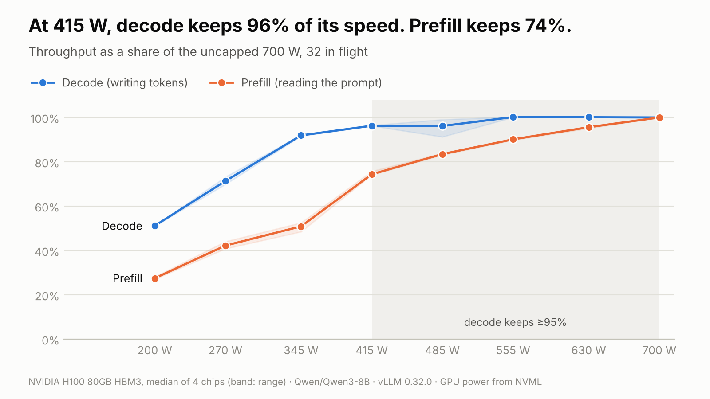

# tokens-per-watt

How a GPU's power limit changes inference speed, measured separately for prefill and decode.

Capped at 415 W instead of 700 W, an H100 SXM keeps 96% of its decode speed and 74–75% of its
prefill speed. Decode gets 23–27% more tokens per joule.

Write-up: [Power limits and inference](https://nickcrews.org/blog/power-limits-and-inference).



## Why

- **Decode waits on memory.** A cap slows the cores, not the memory, so they mostly wait less.
- **Prefill is math.** It slows with the clock.
- **Lower clocks save energy.** They allow lower voltage, and power scales with voltage squared.
- **Batches feel it more.** More math per byte makes decode act like prefill.
- **Too low backfires.** Below about 345 W the SXM clock collapses (345 MHz at 200 W), likely
  because voltage hits its floor while memory and board keep their share. The PCIe card holds
  900 MHz at 200 W.

## Results

Two 8-card machines, vLLM 0.32.0, one engine per card: four on Qwen3-8B, four on Qwen3-14B.
Each card is compared with its own uncapped run. Figures are medians at 32 requests in flight;
ranges span the two models.

**H100 SXM** (700 W max)

| Limit | 485 W | 415 W | 345 W | 270 W | 200 W |
| --- | --- | --- | --- | --- | --- |
| Decode speed | 96–99% | 96% | 91–92% | 71% | 51–58% |
| Decode tokens/J | +5–12% | +23–27% | +41–45% | +41–45% | +29–36% |
| Prefill speed | 83% | 74–75% | 51–56% | 42–44% | 27–28% |
| Prefill tokens/J | +20% | +25–27% | +3–13% | +9–13% | −5 to −3% |

**H100 PCIe** (350 W max)

| Limit | 305 W | 245 W | 200 W |
| --- | --- | --- | --- |
| Decode speed | 100% | 96% | 86–87% |
| Decode tokens/J | +2–3% | +21–23% | +33–36% |
| Prefill speed | 88–90% | 68% | 53% |
| Prefill tokens/J | +1–2% | −3% | −8% |

Charts and raw data: [`results/h100-sxm`](results/h100-sxm), [`results/h100-pcie`](results/h100-pcie)
(`gpu0`–`3` Qwen3-8B, `gpu4`–`7` Qwen3-14B). One PCIe card, GPU 7, never drew more than about
307 W on prefill; it moves the 14B median by one point.

Settings: `vllm serve MODEL --no-enable-prefix-caching --max-num-seqs 64 --max-model-len 8192`,
`tpw-sweep --steps 8 --concurrency 1,32 --duration 15 --repeats 2 --settle 5`.

## Run it

Needs root on a host that allows `nvidia-smi -pl`. Bare metal is safest; some cloud VMs refuse.

```bash
uv sync
vllm serve Qwen/Qwen3-8B --no-enable-prefix-caching --max-num-seqs 64 &
sudo .venv/bin/tpw-sweep --gpu 0 --out gpu0.jsonl      # ~35 minutes
.venv/bin/tpw-plot gpu0.jsonl --out charts            # --theme dark
```

Any server with OpenAI-compatible `/v1/completions` works. The sweep restores the original power
limit when it ends, fails or is interrupted. Pass several files (`tpw-plot gpu0.jsonl gpu1.jsonl`)
to plot the median across cards with their range. `scripts/demo.sh` streams a capped and an
uncapped card side by side.

Without a GPU (made-up numbers, watermarked charts):

```bash
uv run tpw-sweep --simulate --duration 2 --repeats 1 --out sim.jsonl && uv run tpw-plot sim.jsonl
```

## How it measures

At each limit, from max to min: decode (512 output tokens) and prefill (4,096-token prompts), at
1 and 32 requests in flight. Energy comes from the GPU's own counter (NVML). Prompts are random
tokens, so the prefix cache can't skip prefill. Chart titles are computed from the data.

## Caveats

- GPU power only: no CPU, memory, networking or cooling.
- A power cap lets the card pick its clock. Locked clocks (`nvidia-smi -lgc`) are not tested.
- Results hold for these cards, models, engine and batch sizes.

## Prior art

Patel et al., *Characterizing Power Management Opportunities for LLMs in the Cloud* (ASPLOS '24);
ML.ENERGY / Zeus. This repo is a small, reproducible measurement that splits prefill from decode.

## Development

```bash
uv run ruff format && uv run ruff check && uv run mypy && uv run pytest
```

MIT license.
