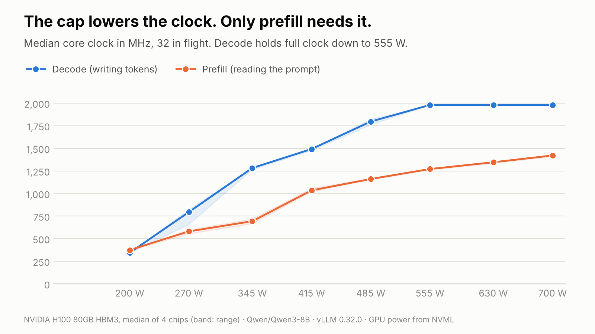
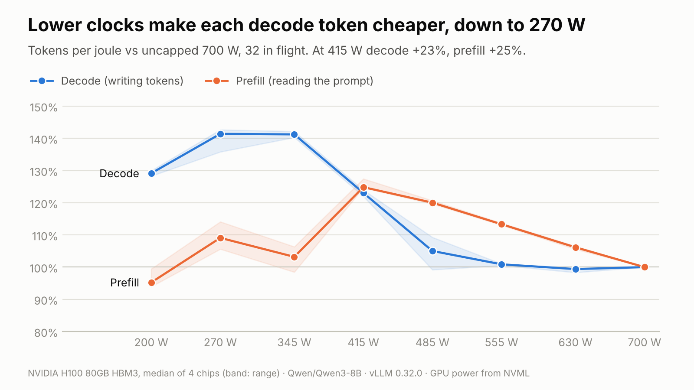

# Power limits and inference

A GPU's power limit is one setting. This measures what it does to the two halves of inference:
prefill (reading the prompt) and decode (writing tokens).

**Setup.** Eight H100 SXM cards (700 W max), one vLLM 0.32.0 engine per card: four on Qwen3-8B,
four on Qwen3-14B. Each card was swept from 700 W down to 200 W, with 32 requests in flight. Each
card is compared with its own uncapped run; figures are medians across a model's four cards, and
ranges span the two models. The same sweep ran on eight H100 PCIe cards (350 W max).

## Decode barely slows

At 415 W, decode keeps 96% of its speed. Prefill keeps 74–75%.

## Why: the clock

A power cap works by lowering the core clock. At 415 W:

- Prefill's clock falls 25% and its speed falls 26%. It is compute-bound: speed follows clock.
- Decode's clock falls 24% and its speed falls 4%. It is memory-bound: each step reads every
  weight from memory and does little math per byte, so the cores were mostly waiting anyway.

Uncapped, decode draws only 520–535 W. Limits above that don't touch it.

## Lower clocks are cheaper per token

A lower clock lets the chip run at a lower voltage, and power scales with voltage squared. Energy
per token falls faster than speed.

At 415 W, decode gets 23–27% more tokens per joule and prefill 25–27%. Decode's efficiency peaks
at 270–345 W (+41–45%), but by 270 W it has lost 29% of its speed.

## Where it breaks

Below about 345 W the clock collapses: decode runs at 345 MHz at 200 W, and keeps only 51–58% of
its speed. Prefill hits the same wall earlier. From 415 W to 345 W its clock falls 37% while the
limit falls 17%, and its efficiency gain mostly disappears.

The likely cause is the voltage floor. Once voltage can't drop further, every watt saved comes from
the clock alone, while memory and the rest of the board keep drawing their share. We didn't
measure voltage, so this is inference.

Larger batches do more math per weight read, so decode starts to behave like prefill. At 270 W,
decode keeps 85% of its speed with 1 request in flight and 71% with 32.

## The PCIe card

The H100 PCIe shows the same split with no cliff. At 245 W decode keeps 96% of its speed for 21–23%
more tokens per joule, and prefill keeps 68%. At its 200 W floor decode still keeps 86–87%, with
the clock at 900–1,000 MHz.

One difference we can't fully explain: on PCIe, prefill gets slightly *less* efficient under a cap
(−3% at 245 W).

## Takeaways

- Decode doesn't need full power. On an H100 SXM, 415 W costs it 4% of its speed and saves about a
  fifth of the energy per token.
- Prefill does need full power: its speed follows the clock.
- Don't cap below about 345 W on SXM. The clock collapses and the savings shrink.

## Caveats

- GPU power only: CPU, networking and cooling are not counted.
- Two models, one engine, batch sizes of 1 and 32, four cards per model.
- A power cap lets the card choose its clock. Locked clocks weren't tested.

Raw data, every chart and the code to rerun it are in this repo: see the [README](README.md).
